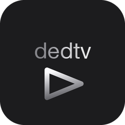

<p align="center"></p>

# dedplay IPTV Player

Android TV, Android telefon/tablet ve Android tabanlı araç multimedya kutuları (AI box) için IPTV oynatıcı.

Bu uygulama sadece bir **oynatıcıdır**. İçerik, sizin kendi (yasal) M3U listenizden veya Xtream hesabınızdan gelir.

[](https://github.com/berzahbey/dedplay-android-ip-tv/releases/latest)

**Son sürüm:** [⬇️ dedplay.apk indir](https://github.com/berzahbey/dedplay-android-ip-tv/releases/latest/download/dedplay.apk)  ·  [sürüm notları](https://github.com/berzahbey/dedplay-android-ip-tv/releases/latest)

Bu bağlantı her zaman en son sürümü indirir; telefonda, tablette ve araç kutusunda tarayıcıdan açılabilir.

**Gizlilik Politikası:** [PRIVACY_POLICY.md](PRIVACY_POLICY.md)

---

## Hangi cihazlarda çalışır?

| Cihaz | Durum | Kontrol |
|---|---|---|
| **Android TV / Google TV** (Xiaomi TV, Mi Box, Chromecast with Google TV, Android TV kutuları) | ✅ Tam destek | TV kumandası |
| **Android telefon ve tablet** | ✅ Tam destek | Dokunmatik ekran; yatay ve dikey kullanım |
| **Android tabanlı araç kutuları (AI box)** | ✅ Çalışır | Dokunmatik ekran + **direksiyon tuşları** ile kanal değiştirme |
| Bluetooth kumanda / klavye / kulaklık tuşları | ✅ | Sonraki/önceki = kanal değiştir, oynat/duraklat |
| Samsung (Tizen), LG (webOS) TV, Apple TV, iPhone | ❌ | Bu sistemlere APK kurulamaz; Android TV kutusu/çubuğu gerekir |
| Sadece CarPlay / Android Auto adaptörü (kendi Android'i olmayan kablosuz adaptörler) | ❌ | Uygulama kurulabilen, kendi Android sistemi olan kutu gerekir |

En az **Android 6.0** gerekir.

> 🚗 **Araçta güvenlik:** Video sadece araç **park halindeyken** izlenmelidir. Hollanda dahil birçok ülkede sürüş sırasında sürücünün ekranda video izlemesi yasaktır. Bazı araç kutuları araç hareket edince videoyu kendiliğinden kapatır.

---

## Özellikler

- **Kaynaklar:** Xtream kodları, M3U linki veya **M3U dosyası** (telefondan, USB'den, Download klasöründen)
- **Canlı TV:** gruplar, ★ favoriler, grup gizleme, kanal numarasıyla geçiş, önceki kanala dönüş
- **Yayın akışı (EPG):** şimdiki/sıradaki program ve ilerleme çubuğu (Xtream); kanal grubuna göre **saat farkı düzeltmesi** (örn. Türkiye kanalları Hollanda'dan izlenirken)
- **Kayıt:** izlenen kanalı kaydet, şu anki programı bitene kadar kaydet, yayın akışından **ileri saate kayıt planla**; TV hafızasına veya **USB belleğe**; uygulama arka plandayken de devam eder
- **Çoklu ekran:** 2'li veya 4'lü; her karo farklı M3U / Xtream kaynağından seçilebilir; ses seçili karodan gelir
- **Filmler ve diziler** (Xtream), sezon/bölüm listesi
- **Arama:** kanal, film ve dizi adında
- **Ses ve altyazı seçimi;** varsayılan ses dili Türkçe
- **Görüntü oranı** (Sığdır / Doldur / Uzat), **tampon** ayarı, **uyku zamanlayıcı**
- **Donma koruması:** görüntü donarsa ya da yayın koparsa kanal kendiliğinden yeniden açılır
- **Yedekleme:** kaynaklar, favoriler ve gizli gruplar Download klasörüne yedeklenir / geri yüklenir
- **Hesap bilgisi:** Xtream bağlantı sayısı ve bitiş tarihi

---

## Kurulum

### Android TV / Google TV
**Yol A — USB bellek**
1. [dedplay.apk](https://github.com/berzahbey/dedplay-android-ip-tv/releases/latest/download/dedplay.apk) dosyasını indirip USB belleğe kopyalayın, TV'ye takın.
2. TV'de bir dosya yöneticisi (örn. "File Commander", "X-plore") ile APK'yı açıp kurun.
3. İzin isterse: Ayarlar > Güvenlik > **Bilinmeyen kaynaklar** > dosya yöneticisine izin verin.

**Yol B — Wi-Fi ile (bilgisayardan)**
1. TV'de: Ayarlar > Cihaz tercihleri > Hakkında > **Derleme** satırına 7 kez OK → Geliştirici seçenekleri açılır.
2. Geliştirici seçenekleri > **USB hata ayıklama / Ağ hata ayıklama** açın; TV'nin IP adresini not edin.
3. Bilgisayarda:
   ```bash
   adb connect TV_IP_ADRESI:5555
   adb install -r dedplay.apk
   ```

### Android telefon / tablet
1. Telefonun tarayıcısında şu bağlantıyı açın, APK iner: https://github.com/berzahbey/dedplay-android-ip-tv/releases/latest/download/dedplay.apk
2. İndirilen dosyaya dokunun; "Bilinmeyen uygulamaları yükle" izni isterse tarayıcıya izin verin.

### Araç kutusu (AI box)
- Kutunun tarayıcısıyla APK'yı indirip kurun **veya** APK'yı USB belleğe kopyalayıp kutunun dosya yöneticisiyle kurun.
- Direksiyondaki **sonraki / önceki** tuşları kanal değiştirir. Çalışmazsa kutunun ayarlarında direksiyon tuşlarının "medya tuşu" olarak gönderildiğinden emin olun.

> Güncelleme: yeni APK'yı eskisinin **üstüne** kurun; kaynaklar, favoriler ve ayarlar silinmez.

---

### Güncelleme

v1.9 ve sonrası kendini günceller: uygulama günde bir kez GitHub'daki son sürüme bakar, yeni sürüm varsa haber verir. **Ayarlar > ⬆ Güncelle** ile indirilir ve Android'in kurulum ekranı açılır; **Yükle**'ye basmanız yeterli (ayarlar ve favoriler silinmez). İlk seferde Android "bu kaynaktan yüklemeye izin ver" onayı ister. Elle denetlemek için: Ayarlar > *Güncellemeleri denetle*.

## İlk kullanım

1. Uygulamayı açın; **Kaynak Ekle** ekranı gelir.
2. Birini seçin:
   - **Xtream Kodları:** sunucu (örn. `http://sunucu.com:8080`), kullanıcı adı, şifre
   - **M3U Linki:** `http://...` ile başlayan liste linki
   - **M3U Dosyası:** **Dosya seç** ile cihazdaki `.m3u` / `.m3u8` dosyası
3. **Kaydet ve Bağlan**. İlk yükleme büyük listelerde 1-2 dakika sürebilir; liste saklanır ve varsayılan olarak **haftada bir** kendini yeniler. Ayarlar > *Otomatik liste yenileme*: her açılışta / günde bir / 3 günde bir / haftada bir / kapalı. Elle: Ayarlar > *Listeyi şimdi yenile*.

---

## Kullanım

### TV kumandası (canlı yayın)

| Tuş | Ne yapar |
|---|---|
| **◀ SOL** | Kanal listesi → (tekrar) Gruplar → (tekrar) Menü |
| **▶ SAĞ** | İzlenen kanalın seçenekleri: ses, altyazı, görüntü oranı, kayıt, yayın akışı, çoklu ekran, uyku |
| **▲ / ▼**, CH+ / CH− | Sonraki / önceki kanal |
| **OK** | Kanal listesi |
| **OK'a uzun bas** | İzlenen kanalı favoriye ekle / çıkar ★ |
| **Rakam tuşları** | Kanal numarası (listede görünen sıra) |
| **0** | Önceki kanala dön |
| **Menü** tuşu | Seçenekler paneli |
| **Geri** | Açık paneli kapatır; panel kapalıyken **iki kez Geri** = çıkış (Ayarlar > *Geri tuşu* ile sadece Home'a çevrilebilir) |

Listelerde: OK = seç, **uzun OK** = kanalı favoriye ekle (kanal listesinde) / grubu gizle (grup listesinde).
**Gizlenen grupları geri açmak:** Ayarlar > *Canlı TV / Film / Dizi gruplarını yönet*.

**Çalışmayan kanalları bulmak (sadece M3U):** Ayarlar > *Çalışmayan kanalları bul*. Uygulama listedeki kanalları sırayla dener, yayın vermeyenleri ✕ ile işaretler; Ayarlar > *Çalışmayan kanalları gizle* ile listeden kaldırılır. Xtream hesaplarında bağlantı sınırı yüzünden bu tarama kapalıdır.

**Tek kanal gizlemek:** kanal açıkken Seçenekler (▶ / Menü) > *Kanalı listeden gizle*. Geri açmak: Ayarlar > *Gizli kanalları geri aç*.

Film/dizi oynatırken: OK duraklat · ◀▶ 10 sn · ▲▼ 1 dk · uzun OK veya Menü = ses/altyazı.

### Dokunmatik ekran (telefon, tablet, araç kutusu)

| Hareket | Canlı yayında | Film/dizide |
|---|---|---|
| Dokun | Kanal listesi (üstte ◀ Gruplar · Ara · Menü · Seçenekler); 5 sn dokunulmazsa kendiliğinden kapanır | Bilgi bandı / duraklat-oynat |
| Yukarı / aşağı kaydır | Sonraki / önceki kanal | – |
| Sağa kaydır | Kanal listesi → gruplar → ayarlar | – |
| Sola kaydır | Bir geri (gruplar → kanallar → kapat); panel kapalıyken kanal seçenekleri | – |
| Geri (iki kez) | Uygulamadan çıkış | – |
| Basılı tut | Seçenekler (ses, altyazı, kayıt…) | Ses / altyazı |
| Çift dokun (sol / sağ) | – | 10 sn geri / ileri |
| Listede dokun / basılı tut | Seç / favoriye ekle | – |

### Direksiyon ve medya tuşları

| Tuş | Canlı yayında | Film/dizide |
|---|---|---|
| Sonraki ⏭ | Sonraki kanal | 30 sn ileri |
| Önceki ⏮ | Önceki kanal | 30 sn geri |
| Oynat / Duraklat ⏯ | Duraklat / devam (kanal yeniden açılır) | Duraklat / devam |

### Çoklu ekran
Menü > *Çoklu ekran* (veya Seçenekler'den). Oklar/dokunma ile karo seçin; OK / seçili karoya tekrar dokunma = kanal değiştir; uzun OK / basılı tutma = tam ekran. Düzen (2'li / 4'lü) kanal seçicinin en üstünde.

### Kayıt
- Canlı yayında **▶ (Seçenekler)**: *Kanalı kaydet*, *Bu programı kaydet*, *Yayın akışı · kayıt planla*.
- Menü > **Kayıtlar**: kayıtları izle (OK), sil (iki kez uzun OK), planları iptal et.
- Ayarlar > **Kayıt yeri**: TV hafızası / USB bellek.

> ⚠️ **Bağlantı sayısı:** Her çoklu ekran karosu ve izlerken yapılan her kayıt, sağlayıcıya ayrı bir bağlantı açar. Hesabınız **tek bağlantılı** ise izlerken kayıt veya çoklu ekran izlemeyi kesebilir. Bağlantı sayınızı **Ayarlar > Hesap bilgisi**'nde görebilirsiniz.

---

## Sorun giderme

- **Kanal açılmıyor:** Ayarlar > *Yayın formatı* `m3u8` ↔ `ts` değiştirin. Bazı kanallar ilk denemede sunucu tarafında gecikir; uygulama kendiliğinden yeniden dener.
- **Liste boş / yüklenemedi:** Link/şifre doğru mu? Ayarlar > *Listeyi yenile*.
- **Yayın akışı saati kaymış:** o kanal açıkken ▶ > *Yayın akışı saat farkı* (grup bazında kaydedilir).
- **Ses yanlış dilde:** ▶ > *Ses* ile değiştirin; seçim hatırlanır.
- **M3U dosyası seçilemiyor:** Bazı Android TV'lerde sistem dosya seçicisi yoktur; dosyayı bir sunucuya koyup *M3U Linki* olarak ekleyin.
- **Filmler/Diziler boş (M3U):** Düz M3U listeler film/dizi ayrımı içermeyebilir; Xtream kodlarıyla tam çalışır.
- **Yazı yazmak zor (TV):** Telefona "Google TV" uygulamasını kurun, telefon klavyesiyle yazın.

---

## Kaynaktan derleme

**Android Studio:** File > Open > bu klasör → Build > Build APK(s). Release için *Build Variants* panelinde `release` seçin.

**Terminal (macOS):**
```bash
# Gradle 8.7, Java 17 veya 21 ile çalışır (Java 25 desteklenmez)
export JAVA_HOME="/path/to/jdk-21"
gradle assembleRelease          # veya: ~/.gradle/wrapper/dists/gradle-8.7-bin/*/gradle-8.7/bin/gradle
# Çıktı: app/build/outputs/apk/release/dedplay.apk
```

Release sürümü debug anahtarıyla imzalanır; böylece yeni APK eskisinin üstüne kurulur.

### Proje yapısı
- `AppViewModel.kt` — uygulama mantığı, oynatıcı, donma koruması, ses/altyazı, EPG, medya oturumu
- `Repository.kt` — Xtream API, M3U indirme, EPG, hesap bilgisi
- `Recorder.kt` / `RecordService.kt` — kayıt motoru ve arka plan servisi
- `Store.kt` — kaynaklar, favoriler, ayarlar, yedekleme
- `M3uParser.kt` — M3U okuyucu
- `ui/` — ekranlar: `LiveScreen` (canlı TV), `MultiScreen` (çoklu ekran), `RecordingsScreen`, `SearchScreen`, `BrowseScreen` (film/dizi), `PlayerScreen`, `SettingsScreens`, `AddSourceScreen`; ortak bileşenler `Components.kt`, `Options.kt`
